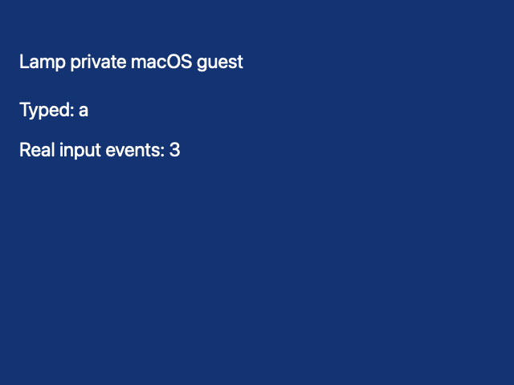

# T15 — Mac devices and restricted native tasks

## Coordinator follow-up: real device and trusted-origin demonstrations

The four requested follow-up demonstrations now work. Public SDK/per-sandbox
Device API wiring remains deferred to T28 as agreed. No benchmark, trial-count,
soak, attack-suite or timing target was used. All VM runs below were confined,
used generated fixtures and released their disposable guests.

| Feature | M5 | 8 GiB M2 Air |
| --- | --- | --- |
| Linux display and disk | 640 × 480 framebuffer read/write; 4,096-byte extra-disk round trip | same, admitted 768 MiB guest |
| Linux keyboard and mouse | actual evdev key-down/key-up and absolute pointer events from uinput | same |
| Virtual audio input/output | guest FIFO recording to WAV and playback back through vsock, Linux and macOS | same transport in Linux |
| Native macOS display | actual guest display ID 1, 640 × 480 pixels; AppKit image below | remains refused under current memory headroom |
| Native macOS disk/GPU | 4,096-byte extra-disk round trip; Metal on `Apple Paravirtual device`, 64 verified computed values, last value 196 | no claim of an admitted native guest |
| Native macOS keyboard/mouse | guest AppKit queue delivered key code 0 down/up, typed `a`, pointer `(123,234)` | native guest correctly remains refused |
| Trusted public-CI refusal | authenticated public job refused through real control service, including forged owner/private claims | same |

Final raw records:

- [M5 Linux transport](evidence/t15/M5-linux-transport/result.json)
- [Air Linux transport](evidence/t15/Air-linux-transport-final/result.json)
- [M5 native macOS, no host UI frontend](evidence/t15/M5-macos-headless-final/result.json)
- [M5 trusted native control](evidence/t15/M5-native-control-4/result.json)
- [Air trusted native control](evidence/t15/Air-native-control/result.json)



### What the transports actually do

Audio is fixed-format mono signed 16-bit little-endian PCM at 48 kHz.
`lamp-guest-devices` creates input/output FIFOs only when requested. Lamp's
private vsock command channel streams a generated tone into the guest, a
guest recorder reads the input FIFO into `recording.wav`, and a guest player
writes the WAV's samples to the output FIFO. The host drains and checks the
returned samples. All three final guest runs recorded and played 9,600 bytes,
SHA-256 `69645c5d481174d63fe759c3b0b41e1f05c1c4db8b9c84676652ddcad2e5fc51`.
Injected, recorded and played WAV files are retained alongside each record.
There is no host microphone, speaker or VZ host-audio attachment.

Linux input uses a real guest uinput device and reads the resulting events
from evdev: `[1,30,1]`, `[1,30,0]`, `[3,0,123]`, `[3,1,234]`, with synchronization
events. The device-capable kernel includes built-in `INPUT_UINPUT` and `EVDEV`.
The [exact configuration](evidence/t15/kernel-input.config) SHA-256 is
`f536e8ac791fc0509c15d67074ee116bf34e590470c470263ef52378741e37ee`;
the Image SHA-256 is
`c04d4afde9721300f8452de7573472e9fc19546d11fdd94f6f36a068b0804f1c`.
The [seed metadata](evidence/t15/device-seed-input.json) binds those inputs.

macOS uses an explicit **guest-application input endpoint**, not system-wide
HID injection. The device broker validates requested keyboard/mouse flags and
sends events to the configured private Unix socket. The native receiver posts
real `NSEvent`s through its AppKit event queue; its responder handles them,
updates visible text and writes the observed-event record and PNG. The receiver
acknowledges only after its responder has processed the events. This requires an
opt-in application receiver; arbitrary third-party desktop application control
and public endpoint discovery are not claimed. No host accessibility or input
monitoring permission was requested.

The final M5 build creates **no host NSApplication, NSWindow or screen-capture
frontend**, and adds no WindowServer, replayd or TCC grants to the VZ worker.
The AppKit application runs solely inside the disposable guest. Its actual
`CGMainDisplayID()` is 1 and its pixel size is 640 × 480; the screenshot is its
own rendered view, not a capture of the owner's screen or other applications.

### Memory and native fallback authority

The native template's `machine.json` declares minimum/default resources of
2 vCPUs, 4,096 MiB and 48 GiB. The final M5 run used that minimum memory.
Earlier M5 refusals remain retained below. Verification reads now use
`F_NOCACHE` rather than filling the host page cache immediately before admission;
no admission limit or owner application was changed to make the guest fit.
Oversized 32 GiB requests were refused before sandbox-directory creation on
both machines. The Air native refusal is retained in the historical records;
its latest native fallback run observed 8,192 MiB physical and 1,774 MiB
available memory, not enough for the 4 GiB guest plus VMM allowance.

`lampd --native-fallback-file` loads a custodian-owned, non-group/world-writable
authority document without following symlinks. It binds credential SHA-256 to
immutable job ID and repository visibility. The service copies that configuration
at startup; request `origin`/visibility fields are not authority. Unknown job
credentials fail closed. Public-job mutations, including ordinary sandbox
creation, are refused before dispatch; the internal native-task route applies
the same policy.

On each Mac a valid enrolled public-job credential successfully read fleet
metadata, then received HTTP 403 / `VM_REQUIRED` for both forged-owner native
execution and ordinary sandbox creation. The message identifies
`jb_public_fixture (public)`. **Zero public-CI sandboxes were created.**
An owner-authorized task on the same service ran system SQLite and returned
`42`, explicitly reporting `app_sandbox_process` / `weaker_than_vm`.
Login and protected-connection flags remain refused; networking is denied.

There is **no machine-wide admission ledger**. Reservations are still per
engine; unrelated supervisors/native launchers are not globally coordinated.
Native App Sandbox memory admission is not a VM-sized resident-memory limit.
Linux accelerated 3D remains explicitly unavailable on this VZ backend.
Optional-device capture/suspend is refused rather than silently dropping state.

### Reproduction and verification

Use the prepared T8 macOS template and a signed device-capable Linux template.
Build `lamp-vz`, `lamp-supervisor`, `lamp-native` and `lamp-guest-devices`; copy
the host binaries to a disposable directory and ad-hoc sign the VM worker with
`crates/lamp-vz/lamp-vz.entitlements`. Keep the intentionally unentitled native
launcher separate. Compile the guest fixture with:

```sh
clang -fobjc-arc infra/mac/demo-input.m -framework AppKit -o target/t15-input-observer
```

`infra/mac/demo-devices.py` accepts `--bin`, `--guest`, `--memory-mib`,
`--source-store`, `--template-name`, `--guest-bridge`, and for native macOS
`--gpu-demo` / `--mac-input-observer`. It uses only its own temporary supervisor,
private disks, identity pool and guest. Native GUI setup creates a disposable
guest account with a guest-generated credential, reboots it, re-applies the
same sandbox identity with fresh entropy and starts the receiver in that guest's
Aqua session. Credentials never enter host arguments, logs or evidence.
`--command-timeout-ms` gives these real initialization commands an explicit
bounded command budget; it is not a performance target.

`infra/mac/demo-native-control.py` accepts `--daemon`, `--launcher`, `--helper`
and a new `--output` directory. It enrolls a fixture credential, restarts the
real control service with the trusted public-job binding and exercises both
refusal paths and the allowed native task.

Scoped checks passed: Rust formatting/type checking; Clippy for the new guest
device binary with warnings denied; Objective-C `-Wall -Wextra -Werror`; Python
syntax compilation; and Go vet for `internal/control` / `cmd/lampd`. No new test
files were added. The continuation's single requested `make verify` invocation
**passed (exit 0)**: workspace build, selected existing smokes, contracts,
interoperability and generated-code checks. It is recorded in
[this log](evidence/t15/make-verify-continuation.log).

All failed/incomplete runs remain in `evidence/t15`, including the unsuccessful
global Quartz and offscreen VZ input attempts. Neither submission success nor
an empty observer record is counted as delivered input. The Air's updated
template save failed with an internal VZ error; the retained
[failure](evidence/t15/Air-input-template-save-failed.log) was not relabeled a
successful snapshot. The final Air demonstration instead cold-booted a fully
verified portable template with optional devices. An initial copied name
symlink pointed at the M5's absolute path; the demo now resolves the template
ID within the selected local store.

## Historical first partial PR snapshot

The remainder records the earlier partial state, before the follow-up above.
Its missing-feature list and verification recovery are historical, not the
current implementation status.

These are real headless observations on the owner's M5 and 8 GiB M2 Air.
Neither SBX-005 nor the whole SBX-006 journey is claimed complete.
No benchmark/trial suite, timing gate, soak, or attack suite was run.
The timings emitted by the existing supervisor are incidental, not objectives.

### Demonstrated

| Feature | M5 | Air |
| --- | --- | --- |
| Linux framebuffer I/O | 640 × 480 × 32 bits; 1,228,800 bytes written and independently read back | same |
| Linux extra disk I/O | 64 MiB private virtio disk; 4,096-byte pattern written, fsynced and read back | same |
| Default-off configuration | VZ validation: zero graphics, keyboards, pointing devices and audio; one primary disk | same, Linux configuration |
| Native fallback | real App Sandbox process runs the system SQLite public-project fixture; returns `42` | same |
| Native outside-file protection | disposable outside fixture cannot be read or changed | same |
| Native network protection | curl cannot reach an independently listening loopback socket; listener sees no connection | same |
| Explicit native policy refusals | public-repository CI, login and protected-connection requests rejected before task execution | same |
| Early oversized allocation refusal | 32 GiB request refused before a sandbox directory exists | same, actual physical memory 8,192 MiB |
| Cleanup | each disposable VM released; task scratch directory removed | same |

The framebuffer's actual readback SHA-256 is
`179802e518ee806d1ca49ba430f8b796e26266a2cc9fb72ebbc41a056b17c8fb`.
The disk pattern's actual readback SHA-256 is
`335ffe8bc68e7f091a1962aba2e56ec26575de6f200febdefeabf4bbc7506f85`.
The fixtures contain generated bytes, Ubuntu/CPython and the system SQLite,
not an owner's project or real vault item.

Raw observations:

- [M5 Linux](evidence/t15/M5-linux-final/result.json)
- [Air Linux](evidence/t15/AIR-linux-final/result.json)
- [M5 native](evidence/t15/M5-native-final/result.json)
- [Air native](evidence/t15/AIR-native-final/result.json)
- [M5 default macOS/Linux configuration and unavailable-device refusals](evidence/t15/M5-config.json)
- [M5 Linux input-controller diagnostic](evidence/t15/M5-input-diagnostic/result.json)

## Missing at the first partial snapshot (superseded above)

- **Audio input/output:** not implemented. Requests explicitly fail with
  `DEVICE_UNAVAILABLE`. The public VZ host audio source/sink uses the host's
  *default* microphone/speakers, with no dedicated-device selector. Those
  attachments are deliberately never constructed. A guest-side virtual
  audio transport or dedicated-device adapter remains to be built.
- **Keyboard/mouse delivery:** opt-in VZ configuration is present, but real
  input events are not delivered by this implementation. Linux shows the
  requested xHCI controller and USB root hubs but no attached input devices.
  This is not counted as working keyboard/mouse I/O. A headless guest input
  transport and its real event demonstration remain.
- **Native macOS guest device and Metal demonstration:** configuration and
  a Metal compute/extra-disk demonstration program exist, but a guest run
  was not admitted under the available host memory. The final M5 attempt
  observed 4,165 MiB available against a 4,096 MiB guest plus 256 MiB VMM
  allowance. The Air observed about 1,518 MiB available. Neither machine's
  owner apps/services were stopped to obtain memory. These are incomplete,
  not successful GPU or macOS device demonstrations.
- **Linux accelerated 3D:** this VZ backend exposes a virtio framebuffer,
  not macOS's accelerated graphics device. Linux GPU requests are refused,
  not presented as hardware-accelerated work.
- **Public control integration:** `--devices JSON` is an explicit supervisor
  configuration and `WorkerSpec.devices` is private engine input. Public
  per-sandbox `Device` requests and input/stream operations are not wired.
  The native helper is an explicit `lamp-vz native-task` path, not an
  automatic public sandbox-create downgrade.
- **CI provenance:** the native launcher requires an `origin` and rejects
  `public_repository_ci`; logins/protected connections default false and
  requests to enable either are rejected. Origin is currently supplied by
  the trusted launcher caller. It is **not yet bound to immutable CI/job
  authority in the control plane**. These request refusals do not establish
  that every public-repository CI path is refused end to end.
- **Admission scope:** aggregate reservations are per engine instance; a
  second independent supervisor/native launcher is not covered by one
  machine-wide reservation ledger. Native memory is admitted, not enforced
  as a VM-sized resident-memory limit.
- **Optional-device capture:** capture/suspend/restore with optional devices
  is explicitly refused rather than dropping device state or an extra disk.
  Existing macOS saved configurations with T8's mandatory graphics/input
  graph are not migrated to the new default-off graph.

## Implementation and reproduction

The worker and supervisor accept an explicit device document, for example:

```json
{
  "display": {"width": 640, "height": 480},
  "keyboard": true,
  "mouse": true,
  "extra_disks": [{"id": "demo", "size_mib": 64}]
}
```

For macOS graphics, `gpu:true` must also be requested. Extra images are
created exclusively inside the sandbox's private directory; no host folder,
clipboard, camera, microphone or owner's desktop is attached.
Optional devices cold-boot a verified template disk instead of parsing a
saved state with a different device graph. Template signatures and object
verification remain in place.

`infra/mac/demo-devices.py` creates a new disposable store, uses only the
specified template, starts its own supervisor with `_lampvm13`–`14`, runs
commands through the supervisor, records results, releases the sandbox and
ends only its own supervisor. Template store keys stay on the host and never
appear in the guest or evidence. Its output directory must be new.

The Linux seed builder now includes DRM/virtio framebuffer, xHCI and HID
drivers and uses a distinct device-capable kernel cache name. The real kernel
was built in a fresh directory on the already-running Lima builder, without
starting/stopping that VM or its services:

- source tarball SHA-256:
  `490a7aedf1b355c565d3a6c05333ccccb5da82064eca46b590448a7099d7d651`
- [actual kernel configuration](evidence/t15/kernel.config), SHA-256:
  `73d82de807e6556d3b338e5ec2f7615d60e12bb0f5e28cb038e4cc44272ef8b6`
- Image SHA-256:
  `f7ffbfc8e60be0f69142e9049d00f447adb6857c98258691fb63e13dd3261b27`
- [verified seed input](evidence/t15/device-seed-v2.json)
- [M5 template preparation](evidence/t15/M5-template-build-v3.log)
- [Air template preparation](evidence/t15/AIR-template-build.log)

The native helper must be packaged with
`sh infra/mac/package-native.sh BINARY NEW_APP_DIRECTORY`.
It receives only `com.apple.security.app-sandbox`, has no network
entitlements, uses a fresh bundle/container identifier, checks that App Sandbox
is active, clears task environment and uses private scratch storage.
A launcher-side private registry prevents reusing a task bundle. Signing is
ad hoc: no certificate/keychain write or approval dialog is required.

`lamp-vz native-task --helper /absolute/Native.app/Contents/MacOS/lamp-native`
reads a bounded JSON request on stdin, with required `origin`, `argv`,
`memory_mib`, `timeout_seconds` and optional `login`/`protected_connection`.
It refuses this route when its virtualization entitlement and VZ support are
available. The demonstrated launcher was a separate copy signed without
virtualization permission; the VM worker retained its virtualization
entitlement. Results say `boundary=app_sandbox_process`,
`isolation=weaker_than_vm`, never `vm`.
`infra/mac/demo-native.py` packages and executes this path with disposable
outside-file and independent loopback fixtures.

Admission reads real physical memory and free/inactive/speculative pages.
Each requested VM/task is charged its declared MiB plus 256 MiB allowance.
The engine reserves up to one quarter of physical memory, capped at 2 GiB,
for the host. Pending allocations and suspended reservations are counted;
running VM reservations are not subtracted twice from current free pages.
An initial additional 512 MiB free-page margin was removed during review
because it duplicated the allowance and was not reported in the refusal.
Earlier refusals under that initial implementation remain on record.

## Failed/incomplete observations retained

All earlier directories under [evidence/t15](evidence/t15/) are retained.
The first Linux graphics run found the missing IOSurface extension grant;
the next exposed the seed's missing graphics/HID drivers. The first Air
worker launch hit traversal permissions on this ticket's own deployment
directory; making that directory traversable fixed it.
The first new seed used the storage object's chunk digest where the seed
requires plain SHA-256; the corrected raw digest is recorded in v2.
A long worktree path exceeded Unix socket path length during template
preparation; the successful preparation uses a short disposable store.
The Air preparation command exceeded the terminal wait timeout, but its log
records successful publication and no worker remained running.
All macOS memory refusals remain as failures/incomplete demonstrations.

Only targeted builds and these demonstrations were used while iterating.
`make verify` was invoked once. It initially stopped because Go traversed a
ticket-created root-owned disposable store under `target/`
([log](evidence/t15/make-verify-initial-failed.log)). That state was moved,
unchanged, outside the checkout. `make build test check-contracts interop`
then completed the workspace build, all selected smokes and contract checks,
but interop hit a transient Go standard-library `internal/abi` lookup error
([log](evidence/t15/make-verify.log)). The directory was present on inspection;
no shared toolchain or project configuration was changed. Retrying only
`tools/interop.py` succeeded
([log](evidence/t15/interop-retry.log)), and
`tools/generate.py --check` also succeeded
([log](evidence/t15/generate-check.log)).

Final review deduplicated capacity-error text, propagated device-unavailable
errors and corrected the newly built macOS template's default graph digest.
The legacy signed macOS disk template remains accepted for cold boot
([read-only verification](evidence/t15/legacy-template-check.log)); legacy
saved device states are not migrated. A targeted final build passed
([log](evidence/t15/final-build.log)).
No full test suite or benchmark loop is substituted for the missing feature
demonstrations. [Final source/artifact hashes](evidence/t15/source-and-artifact-hashes.json)
and measured [M5](evidence/t15/M5-machine.json)/[Air](evidence/t15/AIR-machine.json)
identities are retained separately.
